# Plot - Terminal Charts in Rust



 [](https://crates.io/crates/plot)    

Render sparklines, line charts, candlestick charts, and bar charts directly in the terminal using Unicode block and braille characters with ANSI colors.

Pure Rust, zero dependencies. All chart types produce plain strings with embedded ANSI codes, composable with any TUI framework.

Feature clone of [termchart](https://github.com/isene/termchart).

<br clear="left"/>

## Quick Start

Add to your `Cargo.toml`:
```toml
[dependencies]
plot = { version = "0.1", path = "../plot" }
```

```rust
use plot::{spark, Bar, Orientation, Line, Candle, Color};

// Sparkline
println!("{}", spark(&[1.0, 3.0, 7.0, 2.0, 5.0, 8.0], Some(82)));
// Output: ▁▃█▂▅█ (in green)
```

## Chart Types

### Sparklines

Compact single-line visualization using eighth-block characters (`\u{2581}\u{2582}\u{2583}\u{2584}\u{2585}\u{2586}\u{2587}\u{2588}`).

```rust
use plot::spark;

let s = spark(&[1.0, 4.0, 7.0, 2.0, 8.0, 3.0, 6.0, 9.0, 5.0], Some(82));
println!("{}", s);
// ▁▃▆▂█▃▅█▄
```

- 8 levels of vertical resolution
- Optional 256-color
- Handles empty data and flat values (all same)

### Bar Charts

Horizontal and vertical bars with sub-cell 1/8th precision.

```rust
use plot::{Bar, Orientation};

// Horizontal
let mut bar = Bar::new(50, Orientation::Horizontal);
bar.add("Rust",   95.0, Some(208));
bar.add("Go",     78.0, Some(81));
bar.add("Python", 85.0, Some(226));
bar.add("Ruby",   72.0, Some(196));
println!("{}", bar.render());
```

```
  Rust \u{2502}\u{2588}\u{2588}\u{2588}\u{2588}\u{2588}\u{2588}\u{2588}\u{2588}\u{2588}\u{2588}\u{2588}\u{2588}\u{2588}\u{2588}\u{2588}\u{2588}\u{2588}\u{2588}\u{2588}\u{2588}\u{2588}\u{2588}\u{2588}\u{2588}\u{2588}\u{2588}\u{2588}\u{2588}\u{2588}\u{2588}\u{2588}\u{2588}\u{2588}\u{2588}\u{2588}\u{2588}\u{2588}\u{2588}  95
    Go \u{2502}\u{2588}\u{2588}\u{2588}\u{2588}\u{2588}\u{2588}\u{2588}\u{2588}\u{2588}\u{2588}\u{2588}\u{2588}\u{2588}\u{2588}\u{2588}\u{2588}\u{2588}\u{2588}\u{2588}\u{2588}\u{2588}\u{2588}\u{2588}\u{2588}\u{2588}\u{2588}\u{2588}\u{2588}\u{2588}\u{2588}\u{2588}\u{258E}        78
Python \u{2502}\u{2588}\u{2588}\u{2588}\u{2588}\u{2588}\u{2588}\u{2588}\u{2588}\u{2588}\u{2588}\u{2588}\u{2588}\u{2588}\u{2588}\u{2588}\u{2588}\u{2588}\u{2588}\u{2588}\u{2588}\u{2588}\u{2588}\u{2588}\u{2588}\u{2588}\u{2588}\u{2588}\u{2588}\u{2588}\u{2588}\u{2588}\u{2588}\u{2588}\u{2588}      85
  Ruby \u{2502}\u{2588}\u{2588}\u{2588}\u{2588}\u{2588}\u{2588}\u{2588}\u{2588}\u{2588}\u{2588}\u{2588}\u{2588}\u{2588}\u{2588}\u{2588}\u{2588}\u{2588}\u{2588}\u{2588}\u{2588}\u{2588}\u{2588}\u{2588}\u{2588}\u{2588}\u{2588}\u{2588}\u{2588}\u{258A}           72
```

```rust
// Vertical
let mut vbar = Bar::new(30, Orientation::Vertical);
vbar.set_height(10);
vbar.add("Q1", 80.0, Some(82));
vbar.add("Q2", 95.0, Some(82));
vbar.add("Q3", 60.0, Some(196));
vbar.add("Q4", 110.0, Some(82));
println!("{}", vbar.render());
```

### Line Charts

High-resolution braille dot plotting (2x4 dots per character cell) with Y-axis labels and multi-series legend.

```rust
use plot::Line;

let mut chart = Line::new(60, 15);
chart.add(&[10.0, 15.0, 12.0, 20.0, 18.0, 25.0, 22.0, 30.0], 82, Some("Price"));
chart.add(&[5.0, 8.0, 10.0, 7.0, 12.0, 9.0, 15.0, 11.0], 226, Some("Volume"));
println!("{}", chart.render());
```

- Braille characters (U+2800-U+28FF) for 2x resolution horizontally, 4x vertically
- Bresenham line algorithm for smooth connections
- Y-axis with min/mid/max labels
- Multi-series support with colored legend

### Candlestick Charts

OHLC (Open-High-Low-Close) financial charts with green (up) and red (down) candles.

```rust
use plot::Candle;
use plot::candle::OhlcBar;

let mut chart = Candle::new(50, 15);
chart.add(&[
    OhlcBar { o: 100.0, h: 105.0, l: 98.0,  c: 103.0 },
    OhlcBar { o: 103.0, h: 107.0, l: 101.0, c: 99.0  },
    OhlcBar { o: 99.0,  h: 104.0, l: 97.0,  c: 102.0 },
    OhlcBar { o: 102.0, h: 110.0, l: 100.0, c: 108.0 },
]);
println!("{}", chart.render());
```

- Wicks: `\u{2502}` (thin vertical)
- Bodies: `\u{2588}` (full block) for range, `\u{2500}` (horizontal line) for doji
- Green (82) for up candles, Red (196) for down
- Y-axis with 5 price levels
- Auto-limits visible candles to fit chart width

## Color Support

```rust
use plot::Color;

// 256-color palette (0-255)
let c = Color::Index(82); // green

// RGB hex
let c = Color::from_str("#FF0000").unwrap(); // red RGB
let c = Color::from_str("00FF00").unwrap();  // green RGB

// Named colors (matching termchart)
let c = Color::from_str("red").unwrap();     // → Index(196)
let c = Color::from_str("green").unwrap();   // → Index(82)
let c = Color::from_str("blue").unwrap();    // → Index(33)
let c = Color::from_str("yellow").unwrap();  // → Index(226)
let c = Color::from_str("cyan").unwrap();    // → Index(51)
let c = Color::from_str("magenta").unwrap(); // → Index(201)
let c = Color::from_str("white").unwrap();   // → Index(255)
let c = Color::from_str("gray").unwrap();    // → Index(245)
let c = Color::from_str("orange").unwrap();  // → Index(208)
```

## Canvas API

For custom chart types, use the Canvas and BrailleCanvas directly:

```rust
use plot::{Canvas, BrailleCanvas};

// Simple character canvas
let mut c = Canvas::new(20, 5);
c.set(0, 0, "#", Some(196), None);  // red '#' at top-left
println!("{}", c.render());

// High-resolution braille canvas
let mut bc = BrailleCanvas::new(40, 10);
// Resolution: 80x40 pixels (2x4 dots per character)
bc.set_dot(10, 5, Some(82));  // green dot at pixel (10,5)
println!("{}", bc.render());
```

## API Reference

| Type | Constructor | Methods |
|------|-------------|---------|
| `spark()` | `spark(values, color)` | Returns `String` |
| `spark_color()` | `spark_color(values, color)` | Color enum variant |
| `Bar` | `Bar::new(width, orientation)` | `add(label, value, color)`, `set_height(h)`, `render()` |
| `Line` | `Line::new(width, height)` | `add(values, color, label)`, `y_range(min, max)`, `render()` |
| `Candle` | `Candle::new(width, height)` | `add(bars)`, `render()` |
| `Canvas` | `Canvas::new(w, h)` | `set(x,y,ch,fg,bg)`, `get(x,y)`, `render()` |
| `BrailleCanvas` | `BrailleCanvas::new(w, h)` | `set_dot(px,py,fg)`, `px_width()`, `px_height()`, `render()` |
| `Color` | `Color::Index(u8)`, `Color::Rgb(r,g,b)` | `from_str(s)`, `fg_code()`, `bg_code()` |

## Unicode Characters Used

| Chart | Characters | Description |
|-------|-----------|-------------|
| Sparkline | `\u{2581}\u{2582}\u{2583}\u{2584}\u{2585}\u{2586}\u{2587}\u{2588}` | Eighth-height blocks (8 levels) |
| Bar (H) | `\u{258F}\u{258E}\u{258D}\u{258C}\u{258B}\u{258A}\u{2589}\u{2588}` | Eighth-width blocks (8 levels) |
| Bar (V) | `\u{2581}\u{2582}\u{2583}\u{2584}\u{2585}\u{2586}\u{2587}\u{2588}` | Eighth-height blocks (8 levels) |
| Line | U+2800-U+28FF | Braille patterns (2x4 dots per cell) |
| Candle | `\u{2502} \u{2500} \u{2588}` | Wick, doji, body |
| Y-axis | `\u{2524} \u{2502}` | Label marker, vertical line |

## Part of the Fe2O3 Rust Terminal Suite

| Tool | Clones | Type |
|------|--------|------|
| [rush](https://github.com/isene/rush) | [rsh](https://github.com/isene/rsh) | Shell |
| [crust](https://github.com/isene/crust) | [rcurses](https://github.com/isene/rcurses) | TUI library |
| [glow](https://github.com/isene/glow) | [termpix](https://github.com/isene/termpix) | Image display |
| **[plot](https://github.com/isene/plot)** | **[termchart](https://github.com/isene/termchart)** | **Charts** |
| [pointer](https://github.com/isene/pointer) | [RTFM](https://github.com/isene/RTFM) | File manager |
| [kastrup](https://github.com/isene/kastrup) | [Heathrow](https://github.com/isene/heathrow) | Messaging |
| [tock](https://github.com/isene/tock) | [Timely](https://github.com/isene/timely) | Calendar |
| [scroll](https://github.com/isene/scroll) | [brrowser](https://github.com/isene/brrowser) | Browser |

## License

[Unlicense](https://unlicense.org/) - public domain.

## Credits

Created by Geir Isene (https://isene.org) with extensive pair-programming with Claude Code.
